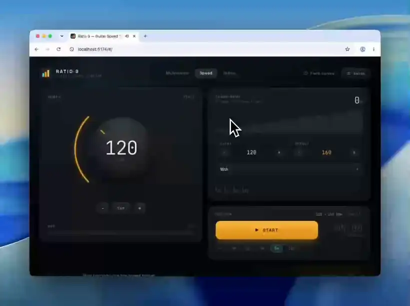

# Ratio·9 — Guitar Speed Trainer

A dual-loop subdivision ratio metronome for guitarists who want to build picking speed systematically, rather than by nudging a tempo dial 5 BPM at a time and hoping.



<sub>Silent loop. [Watch the full-resolution video](https://github.com/user-attachments/assets/9ee07ee9-2692-49cb-a47f-c76657e37956) for a closer look.</sub>

## The idea

Set the click to 100 BPM. Play two bars of eighth-note triplets, three notes per beat. Then, without touching the click, play two bars of sextuplets, six notes per beat.

The pulse never moved. Your picking hand just doubled its speed.

That ratio is the whole point. Getting from 300 to 600 notes per minute by tempo would mean dragging the metronome from 100 to 200 BPM and surviving every broken tempo in between. By changing the subdivision instead, you reach the fast motion immediately, against a beat that stays put — so when the fast pass drifts, you hear it against a reference that did not shift.

The slow pass resets the motion. The fast pass pushes it. That is ratio training, and no metronome app I could find would do it with independent bar counts per subdivision.

## Features

**Three modes**

- **Ratios** — the main event. Two loops, two subdivisions, one fixed BPM. Configurable bars per loop, rest beats between them so the picking hand can reset, and a count-in before round one.
- **Speed** — progressive tempo. BPM ramps automatically after N bars, with four curves: linear, logarithmic, stepback, and pyramid.
- **Metronome** — a straight click. 8 subdivisions, 7 time signatures, configurable accent grouping.

**Sound**

- **Nine engines**, synthesized in the Web Audio graph at click time. Only rim shot and tabla load samples, both CC0.
- **Super Click** (the default) voices its three tiers separately rather than just louder and higher: 1237 Hz accents, 996 Hz on-beats, 825 Hz subdivisions, each a short FM beep with its own length and attack.
- **Per-tier volume** for accents, beats and subdivisions, with subdivision clicks toggleable.

**Practice tooling**

- **Presets** — save and load named configurations, stored in localStorage.
- **Countdown timer** — set a practice duration and get told when it is up.
- **Field manual** — articles on the method, served from markdown in the repo.
- **Keyboard shortcuts** — `Space` start/stop, `1` `2` `3` modes, `T` tap tempo, `←` `→` tempo, `S` setup, `Esc` close.
- **PWA** — installable on desktop and mobile, works offline.
- **Amber-on-dark UI** with reduced-motion support throughout.

## How to actually use it

Short version: add one variable at a time.

1. One note, one string, picking hand only. Ratios at a slow tempo, 2 beats each way.
2. Extend the fast pass: 2 beats, then 4, then 8.
3. Add the fretting hand. Synchronisation only, picking hand stays relaxed.
4. Three notes. Back to 2 beats, build to 8.
5. Extend up the scale, including position shifts.
6. Only now raise the tempo — then rebuild from one note, because the fast motion is a different motion.

The long version, with the diagnostic rules, is in the field manual inside the app.

## Getting started

```bash
npm install
npm run dev      # dev server on localhost:5173
npm run build    # production build to dist/
npm test         # vitest
```

No backend, no API keys, no configuration. React 19 and TypeScript on Vite, with React as the only runtime dependency.

## Project layout

```
src/
  audio/         scheduler and SoundEngine (all nine voices)
  hooks/         one hook per mode, plus settings/presets/timer/routing
  components/    UI panels and the article views
  content/       markdown renderer, loader, and the articles themselves
```

The audio scheduler uses lookahead scheduling against `AudioContext.currentTime` rather than timers, with a guard against catch-up bursts when a background tab is throttled.

## Writing an article

Drop a markdown file into `src/content/articles/`:

```markdown
---
title: Your title
date: 2026-08-09
summary: One sentence, shown on the card and under the headline.
tags: practice, method
---

Body text.
```

That is the whole process. `import.meta.glob` picks it up at build time, the filename becomes the URL slug, reading time is computed, and the newest post is surfaced on the trainer screen automatically. The renderer supports headings, lists, tables, blockquotes, fenced code, links and images, and escapes all text before generating markup.

## Contributing

Issues and pull requests are welcome, whether that is a bug, a new sound engine, or a practice mode I have not thought of.

Run `npm test` before submitting. The suite covers the audio scheduler, accent logic, tempo calculations, and the markdown renderer. If you are adding a sound, `SoundEngine.playClick` is the switch to extend, and `SOUND_OPTIONS` in `src/config.ts` is where it becomes visible in the UI.

## Credits

The method here is not mine. It is assembled from people who explain this far better than I can: [NathanGuitar](https://www.youtube.com/watch?v=Jp-xitAS1kQ), whose video is the direct inspiration for the ratios mode, [Troy Grady](https://troygrady.com) on picking mechanics, and [JustinGuitar](https://www.justinguitar.com), [Ben Eller](https://www.youtube.com/channel/UCcLsvLJOecfCL6RplXhaO4Q), [Bernth](https://www.youtube.com/bernthguitar), [Lukas Kocka](https://www.youtube.com/c/LukasKocka) and [Matt Wright Music](https://www.youtube.com/@mattwright466).

This is a non-commercial project. If something here is yours and you would rather it were not, get in touch and I will remove or change it.

## License

MIT — see [LICENSE](./LICENSE).
